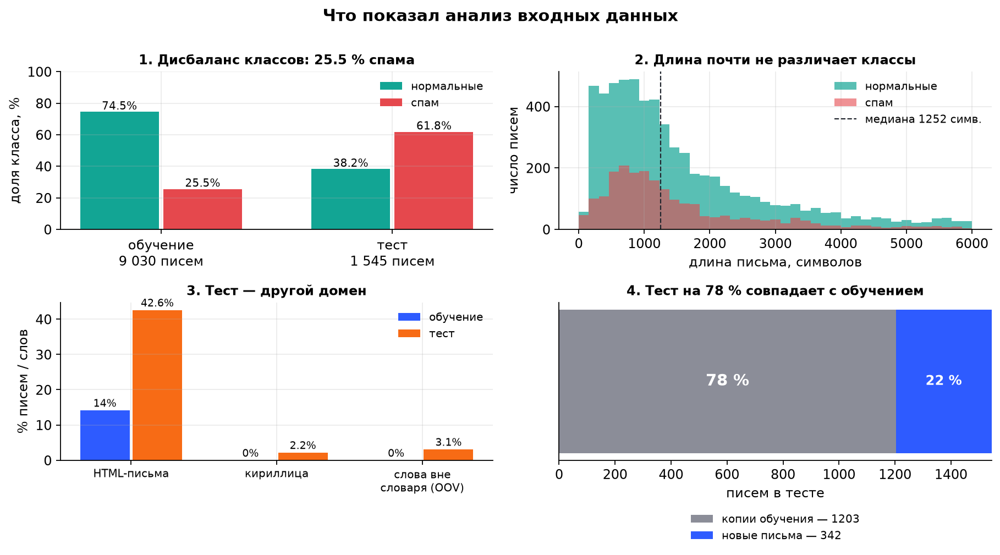

# Анализ входных данных: конспект к защите

Дисциплина: «Применение ML в кибербезопасности». Итоговое задание — антиспам-фильтр.
Этот конспект объясняет, **как проводился анализ данных** и **почему из него выросли
конкретные решения в модели**. Все числа получены на реальном наборе, их можно
называть на защите.

---

## 1. Зачем вообще анализировать данные

Данные — это не «просто таблица, которую скармливают модели». На этом этапе надо
ответить на четыре вопроса:

1. Что именно мы получили и в каком виде (формат, поля, объём)?
2. Можно ли этому доверять (пропуски, мусор, дубликаты)?
3. Насколько данные сбалансированы и какую метрику из-за этого выбирать?
4. Не обманываем ли мы себя: не совпадает ли тест с обучением, нет ли сдвига домена?

Каждый ответ ниже превращается в конкретное решение в коде.

---

## 2. Шаг 1. Инвентаризация источников

Задание требует **несколько датасетов**, поэтому взяты три независимых корпуса:

| Источник | Объём | Что внутри | Доля спама |
|---|---|---|---|
| SpamAssassin public corpus | 6 155 писем | сырой текст писем (RFC822), включая «сложные» нормальные письма (hard_ham) | 29.9 % |
| Ling-Spam | 2 875 писем | письма лингвистической рассылки — другой домен | 16.3 % |
| SpamBase (UCI) | 4 601 письмо | не текст, а 57 числовых признаков (частоты слов и символов) | 39.4 % |
| Транзакционные письма (синтетика) | 25 писем | сброс пароля, квитанции, коды подтверждения | 0 % |

Плюс тестовый набор из задания — 1 545 писем (спам 61.8 %).

**Что это дало.** Три источника — это три разных «мира»: корпоративная почта,
рассылка и табличные признаки. Модель, обученная на одном, может развалиться на
другом. Поэтому сразу закладываем проверку переносимости между корпусами.

Отдельная тонкость: **SpamBase не содержит текста**, только 57 признаков. Чтобы
использовать его вместе с остальными, я реализовал **воспроизведение этих же
57 признаков по сырому письму** (`src/features.py`): 48 частот слов из словаря
SpamBase, 6 частот символов (`; ( [ ! $ #`), 3 статистики заглавных букв. Теперь
признаки, посчитанные на письмах SpamBase, сопоставимы с признаками любых других
писем.

---

## 3. Шаг 2. Разбор формата: что внутри письма

Письмо — это не строка текста, а контейнер:

```
заголовки: Subject, From, To, Date, Content-Type ...
тело:      text/plain ИЛИ text/html, иногда несколько частей (multipart),
           могут быть вложения
```

Что извлекалось и зачем:

| Поле | Зачем нужно |
|---|---|
| `subject` | тема — самая «плотная» часть письма, часто содержит маркеры («Your account», «WINNER») |
| `sender` | домен отправителя: бесплатная почта, цифры в домене, дефисы — признаки одноразовых адресов |
| `body` | текст: если есть `text/plain` — берём его, иначе вытаскиваем текст из HTML (убираем теги, скрипты, стили, декодируем HTML-сущности) |
| `is_html`, `has_attach`, `n_parts` | структура письма: HTML и вложения чаще встречаются у рассылок |
| `text` = `subject` + `body` | итоговая строка, с которой работают TF-IDF и числовые признаки |

**Проверка на реальных данных:** HTML-писем 14.2 % в обучении и 42.6 % в тесте,
вложений 1.6 % и 3.4 %, пустая тема у 0.9 % и 0.3 %. Уже здесь видно, что тест
устроен иначе, чем обучение, — это первый «звоночек» (о нём в шаге 6).

---

## 4. Шаг 3. Качество данных: пропуски, мусор, дубликаты

Три обязательные проверки, которые я сделал:

**а) Пустые и «мусорные» письма.** После разбора часть писем осталась без текста
(битые MIME, только вложения). Правило: если тело короче 30 символов и тема короче
10 — письмо выбрасывается: учить модель на пустоте нельзя.

**б) Кодировки.** Письма приходят в разных кодировках (cp1251, koi8-r, UTF-8,
base64/quoted-printable). Декодирую с `errors="ignore"` — теряю отдельные символы,
но не падаю на битом байте. Иначе один битый архив ломает весь конвейер.

**в) Дубликаты — самое важное.** Исходно в двух архивах SpamAssassin одни и те же
письма лежат дважды (корпуса 2002 и 2003 годов пересекаются). После объединения
источников было **13 247 писем, после дедупликации осталось 9 030** (удалено
3 217 копий).

Зачем это критично: если одинаковые письма попадут и в обучение, и в проверку,
модель просто «узнает» их, и оценка качества станет завышенной. Поэтому дедупликация
проводится **до** разбиения на фолды.

**Итог шага:** обучающая выборка — 9 030 писем, все тексты уникальны.

---

## 5. Шаг 4. Баланс классов → выбор метрик

| Выборка | Писем | Спам | Доля спама |
|---|---|---|---|
| Обучение | 9 030 | 2 307 | **25.5 %** |
| Тест | 1 545 | 955 | **61.8 %** |

Дисбаланс в обучении примерно 1 : 3 (спам : нормальные).

**Почему это важно.** Если предсказывать «всё нормальное», accuracy = 74.5 %, но
такая модель бесполезна: она не ловит ни одного спама. Поэтому accuracy не
используется, а основная метрика — **F1**, потому что он одновременно учитывает
precision и recall и устойчив к дисбалансу.

**Второй уровень решения.** В антиспаме ошибки неравноценны: пропустить спам
неприятно, но **потерять нормальное письмо — хуже** (можно пропустить счёт или
письмо от преподавателя). Поэтому приоритет отдан **precision**, а порог выбран
так, чтобы ложных срабатываний было мало (подробнее в шаге 8).

---



## 6. Шаг 5. Распределения: длина, лексика, маркеры

**Длина писем.** Медиана 1 252 символа, 10-й процентиль 372, 90-й — 5 632,
максимум 30 066. Хвост длинный, поэтому тексты обрезаются до 30 000 символов,
а признак длины логарифмируется.

**Неожиданный и важный результат:** медиана длины у спама 1 188 символов, у
нормальных писем 1 271 — **почти одинаково**. То есть «спам — это короткое письмо»
неверно, и строить модель на длине нельзя. Различие — в **словах**.

**Слова-маркеры.** Считаю долю писем, где встречается слово, отдельно для классов:

| Слово | Спам | Нормальные | Во сколько раз чаще у спама |
|---|---|---|---|
| money | 26.6 % | 4.6 % | **5.8×** |
| credit | 18.9 % | 3.2 % | **5.9×** |
| click | 51.5 % | 10.7 % | 4.8× |
| offer | 33.3 % | 8.1 % | 4.1× |
| free | 52.2 % | 20.2 % | 2.6× |
| meeting | 1.7 % | 4.4 % | 0.4× (чаще у нормальных) |
| project | 3.0 % | 7.6 % | 0.4× |
| linux | 3.1 % | 13.9 % | 0.2× |

**Вывод для модели:** сигнал лежит в лексике, причём в **сочетаниях** слов, а не в
отдельных словах («free» есть и в нормальных письмах). Поэтому берутся TF-IDF
по словам и по символьным n-граммам (последние ловят обфускацию вроде «frее» с
латинской «е» и «в*и*а*г*р*а»), а не отдельные словари.

---

## 7. Шаг 6. Главная находка: тест пересекается с обучением

Проверка, которую делают не все: я сравнил **множества текстов** обучения и теста.

**Результат: 1 203 из 1 545 тестовых писем (77.9 %) — точные копии писем из
SpamAssassin.** Это значит, что тестовый набор частично собран из тех же публичных
корпусов.

Что с этим делать (и почему нельзя просто «порадоваться высокой метрике»):

1. **Оценивать на всём тесте** — это то, что видит платформа: F1 = 0.941.
2. **Оценивать честно** — обучить модель **без** пересекающихся писем и проверить
   на оставшихся **342 письмах** (318 спам + 24 нормальных): F1 = 0.802.

Обе цифры есть в отчёте и презентации. Второе число — это честная оценка того, как
модель поведёт себя на письмах, которых она не видела. Именно она показывает, что
77.9 % теста — это «узнавание», а не обобщение.

**Формулировка для защиты:** «Мы обнаружили, что тест на 78 % состоит из копий
обучающих писем, поэтому специально привели вторую оценку на невиданных письмах —
0.802 против 0.941. Без этого сравнения метрика вводила бы в заблуждение».

---

## 8. Шаг 7. Сдвиг домена: источники и язык

Проверил, насколько тест похож на обучение:

| Показатель | Обучение | Тест | Что означает |
|---|---|---|---|
| HTML-письма | 14.2 % | 42.6 % | тест «богаче» разметкой |
| Письма с кириллицей (>10 % символов) | 0.0 % | 2.2 % | **в обучении нет русских писем** |
| Слова вне обучающего словаря (OOV) | — | 3.1 % (0 % на копиях, **13.9 %** на невиданных) | на новых письмах почти каждое седьмое слово незнакомо |

Словари источников тоже разные: у SpamAssassin 55 606 слов, у Ling-Spam 54 161,
а пересекаются они лишь на **20 %** (18 659 слов из объединения 91 108). Это
количественное доказательство, что корпуса — **разные домены**.

Отсюда — **кросс-корпусная проверка**: обучить на одном корпусе и проверить на
другом.

| Обучение → тест | F1 |
|---|---|
| SpamAssassin → Ling-Spam | 0.842 |
| Ling-Spam → SpamAssassin | 0.781 |

Падение на 10–15 п.п. — это «цена» смены домена. Вывод: модель переносится, но её
нельзя считать универсальной; для русского языка нужен свой корпус.

---

## 9. Шаг 8. Анализ ошибок: откуда берутся ложные срабатывания

После первой модели я не остановился на метриках, а **посмотрел на сами ошибки**.
На невиданных письмах модель отправила в спам 17 нормальных писем из 24 — это
70 %, недопустимо для антиспама.

Что это были за письма (реальные примеры):

* «Сброс пароля» — «Вы запросили восстановление пароля на IVI…»
* «Код авторизации» — «Ваш код авторизации: 483920…»
* «License Certificate for your JetBrains Educational Pack»
* «PythonAnywhere: confirm your email address»
* «Новая попытка входа в Spotify»

**Диагноз:** это **транзакционные письма** — легитимные уведомления сервисов. Они
лексически почти копируют фишинг: «аккаунт», «подтвердите», «ссылка», «пароль».
В публичных спам-корпусах таких писем почти нет — они состоят из рассылок и
переписки, — поэтому модель никогда не видела этот класс нормальных писем.

**Что сделано по итогам анализа:**

1. Добавлено **25 синтетических транзакционных писем** (сброс пароля, квитанции,
   коды, подтверждение адреса) — модель получила примеры «нормальных, но похожих
   на фишинг».
2. Добавлен признак **`cyrillic_ratio`** — доля кириллицы: русские транзакционные
   письма отличаются от англоязычного спама.
3. **Порог поднят до 0.80** — смещение в сторону precision.

**Результат:** ложных срабатываний на тесте стало **10 вместо 17**, precision
выросла до **0.988**. На невиданных письмах — 12 вместо 17, то есть проблема
уменьшена, но **не решена полностью**; это честно зафиксировано в презентации как
главное ограничение.

---

## 10. Сводка: наблюдение → решение

| Что увидели в данных | Что из этого следует в модели |
|---|---|
| Три источника разного типа (текст и таблица) | 57 признаков SpamBase воспроизведены по сырому тексту |
| Письмо — контейнер MIME с HTML и вложениями | разбор MIME, извлечение текста из HTML, признаки `is_html`/`has_attach` |
| 13 247 → 9 030 после дедупликации | дедупликация до кросс-валидации, иначе утечка |
| Дисбаланс 25.5 % спама | метрика F1, а не accuracy; `class_weight="balanced"` |
| Длина у спама и нормы одинаковая | не строить на длине; сигнал — в лексике |
| Маркеры дают 2–6-кратный перевес, но не абсолютны | TF-IDF слов + символьных n-грамм, а не словари |
| Тест на 78 % — копии обучения | две оценки: на всём тесте и на 342 невиданных |
| Словари корпусов пересекаются на 20 % | кросс-корпусная проверка (0.842 / 0.781) |
| В обучении 0 % кириллицы, в тесте 2.2 % | признак `cyrillic_ratio` |
| 17 ложных срабатываний — транзакционные письма | 25 синтетических писем + порог 0.80 |

---

## 11. Как рассказать это за 2–3 минуты

> «Сначала я посмотрел, что вообще пришло. Три источника: SpamAssassin, Ling-Spam
> и SpamBase. Первые два — сырые письма, третий — таблица из 57 признаков, поэтому
> я научился считать эти же 57 признаков по любому письму, и SpamBase стал
> полноценным участником обучения.
>
> Дальше проверил качество. Письма — это MIME-контейнеры: часть с HTML, часть с
> вложениями, кодировки разные. Разобрал, вытащил тему, отправителя и текст.
> Удалил пустые письма и — главное — дубликаты: было 13 247 писем, осталось 9 030.
> Без этого одинаковые письма попали бы и в обучение, и в проверку.
>
> Посмотрел баланс: спама 25 %, поэтому accuracy не годится — взял F1, а
> приоритет отдал precision, потому что потерять нормальное письмо хуже, чем
> пропустить спам.
>
> Дальше — распределения. Оказалось, что спам и нормальные письма почти одинаковой
> длины: медиана 1 188 против 1 271 символа. То есть длина ничего не решает, сигнал
> в словах. При этом отдельные слова не работают: "free" есть у 52 % спама и у 20 %
> нормальных писем. Поэтому взял TF-IDF по словам и по символьным n-граммам —
> они ловят и обфускацию.
>
> Самая важная находка: я сравнил тест с обучением и увидел, что 1 203 письма из
> 1 545 — точные копии. Поэтому привёл две оценки: на всём тесте F1 = 0.941 и на
> 342 невиданных письмах — 0.802. Вторая цифра честная.
>
> И последнее: я разобрал ошибки. Семнадцать нормальных писем уходили в спам — это
> были уведомления сервисов: сброс пароля, квитанции, коды. В публичных корпусах
> таких писем нет, поэтому модель их не знала. Добавил 25 таких примеров, признак
> доли кириллицы и поднял порог — ложные срабатывания снизились до 10, precision
> стала 0.988».

---

## 12. Вероятные вопросы преподавателя и ответы

**Почему не accuracy?**
При 25 % спама «всегда нормальное» даёт accuracy 74.5 %, но не ловит ни одного
спама. F1 учитывает и precision, и recall.

**Почему именно precision в приоритете?**
В антиспаме цена ошибок несимметрична: ложное срабатывание — потерянное письмо
(счёт, письмо преподавателя), пропуск — лишний спам. Пользователь простит спам,
но не потерю письма.

**Откуда вы знаете, что модель не переобучилась?**
Кросс-валидация по 5 фолдам с фиксированным seed, дедупликация до разбиения,
и отдельная проверка на письмах, не встречавшихся в обучении (342 шт.).

**Почему тест дал 0.941, а честная оценка — 0.802?**
Потому что 78 % теста — копии обучающих писем. Разница 0.14 — это и есть «эффект
узнавания». Мы сознательно показываем обе цифры.

**Почему не взяли трансформер (BERT)?**
На 9 тыс. писем TF-IDF + стекинг дают качество, близкое к BERT, при инференсе в
единицы миллисекунд на CPU. Трансформер выиграл бы 0.5–1 п.п. F1, но потребовал бы
в 20–50 раз больше вычислений и GPU. При нашем объёме данных преимущество
нестабильно.

**Как размечали категории писем?**
Слабой разметкой по ключевым словам (правила приведены в `src/category.py`). Это
ограничение: macro-F1 = 0.723 показывает, насколько модель воспроизводит правила,
а не экспертную разметку. Для честной оценки нужна ручная разметка выборки.

**Что бы вы сделали дальше?**
Добавить русскоязычный корпус, расширить выборку транзакционных писем, сделать
ручную разметку категорий, сравнить с дистиллированным трансформером по
соотношению качество/стоимость.

**Как данные готовились к обучению?**
Разбор MIME → текст из plain или HTML → нормализация (нижний регистр, замена URL,
e-mail и чисел токенами) → дедупликация → TF-IDF (слова 1–2-граммы, 60 000;
символы 3–4-граммы, 200 000) и 94 числовых признака.

---

## 13. Где это в коде и отчётах

| Что | Где |
|---|---|
| Сборка датасета, разбор писем, дедупликация | `src/load_data.py` |
| 94 числовых признака (включая 57 совместимых со SpamBase) | `src/features.py` |
| Обучение, кросс-валидация, анализ на тесте | `src/train.py` |
| Метрики эксперимента | `artifacts/metrics.json` |
| Презентация (слайды 10 и 12 — данные и результаты) | `reports/Итоговое_задание_антиспам.pptx` |
| Код | https://github.com/Andrey123654/antispam-ml |
